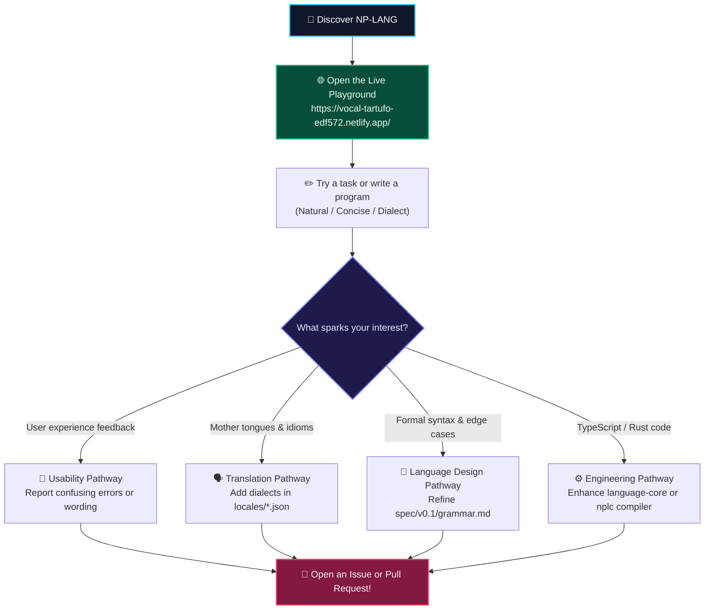

<p align="center">
  
</p>

# Contributing to NP-LANG

Thank you for your interest in contributing to NP-LANG! 

Our goal is to create a programming language that bridges human expression, concise coding, and native compilation. To make this happen, we need perspectives from **beginners, translators, language designers, and systems programmers alike**.

**You do NOT need compiler development experience to contribute.**

---

## 🗺️ The Contributor Journey



---

## 🧭 Choose Your Contribution Pathway

### 1. Test and Report Usability Feedback (Beginners Welcome!)
- **Who**: Anyone who wants to try writing instructions in NP-LANG.
- **How**:
  1. Open the [Live Playground](https://vocal-tartufo-edf572.netlify.app/) (or local dev server).
  2. Attempt the built-in tasks (e.g. *Task 1: Show a message*, *Task 2: Create a score and add to it*).
  3. Tell us where the wording felt awkward, where the instructions were confusing, or where the error messages were unhelpful.
  4. Submit your feedback through the in-browser survey card or by opening a **[Beginner Feedback Issue](https://github.com/victorejike/NPLANG/issues/new)**.

### 2. Improve Language Examples and Translations
- **Who**: Bilingual or multilingual creators.
- **How**:
  - Review our dictionaries in [`locales/`](locales/):
    - `locales/en/dictionary.json` (English)
    - `locales/es/dictionary.json` (Spanish)
    - `locales/yo/dictionary.json` (Yoruba)
  - Propose new standard languages (e.g., French, German, Portuguese, Swahili, Mandarin).
  - Ensure translations preserve exact mathematical meaning, rather than merely replacing English words literally.

### 3. Improve the Specification & Documentation
- **Who**: Technical writers, educators, and language enthusiasts.
- **How**:
  - Review the [Language Specification v0.1](spec/v0.1/grammar.md).
  - Help identify ambiguities (e.g., *"What should happen if two variables have similar names?"*).
  - Write tutorials, practical examples, or clarify documentation in [`docs/`](docs/).

### 4. Code & Compiler Implementation
- **Who**: Software developers comfortable with TypeScript or Rust.
- **How**:
  - **Language Core (TypeScript)**: Help expand parsing, semantic checks, friendly diagnostic suggestions, and the evaluation engine in [`packages/language-core`](packages/language-core).
  - **Playground (React + Vite)**: Improve the web editor, accessibility, mobile layout, or visualization tools in [`playground`](playground).
  - **Native Compiler (Rust)**: Help expand instruction lowering, register allocation, optimizations, and native code generation in [`compiler`](compiler).

---

## 💻 Local Development Workflow

### 1. Fork & Clone
```bash
git clone https://github.com/YOUR_USERNAME/NPLANG.git
cd NPLANG
```

### 2. Install Dependencies
```bash
npm install
```

### 3. Run Tests
Always ensure tests pass before submitting changes:
```bash
# Run the language core test suite
npm test

# Build all packages to check for TypeScript errors
npm run build
```

If working on the native Rust compiler:
```bash
cargo check --manifest-path compiler/Cargo.toml
cargo build --manifest-path compiler/Cargo.toml
```

### 4. Create a Feature Branch
```bash
git checkout -b feature/your-feature-name
```

### 5. Submit a Pull Request
- Give your pull request a clear, descriptive title.
- Explain:
  1. What changed.
  2. Why the change was made.
  3. Which tests you ran to verify it.
- Link any relevant issues being addressed.

---

## 🏷️ GitHub Issue Labels

When opening or searching for issues, look for these labels:
- `good first issue` — Small, well-defined tasks for newcomers.
- `help wanted` — Tasks where community help is actively needed.
- `beginner feedback` — Reports from users trying NP-LANG for the first time.
- `language design` — Discussions on syntax, grammar, and scoping rules.
- `documentation` — Improvements to guides, tutorials, and specifications.
- `compiler` — Work on parsing, analysis, code generation, and runtime performance.
- `needs discussion` — Decisions that require broader community consensus.

---

## 🤝 Code of Conduct

All contributors and participants are expected to adhere to our [Code of Conduct](CODE_OF_CONDUCT.md). Please maintain a respectful, welcoming, and collaborative environment.
