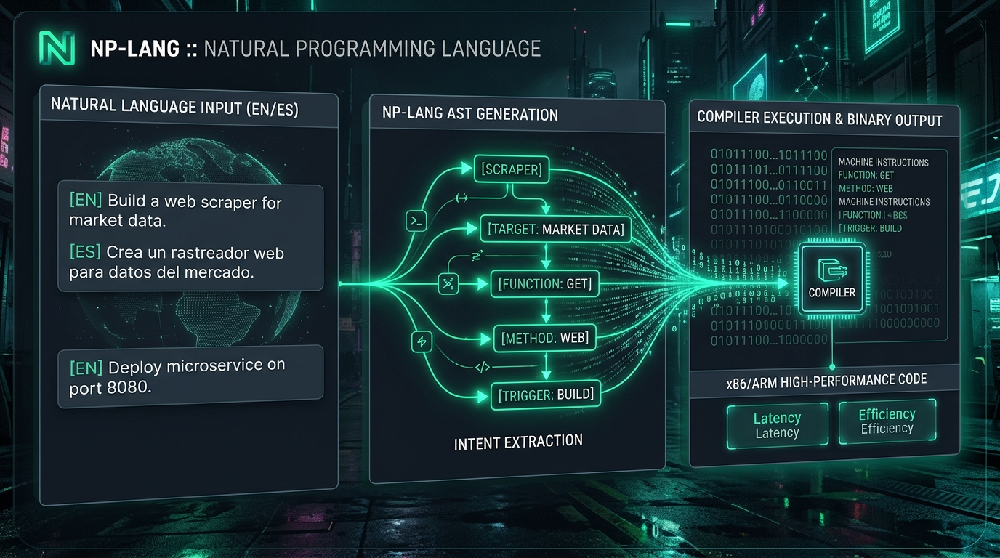
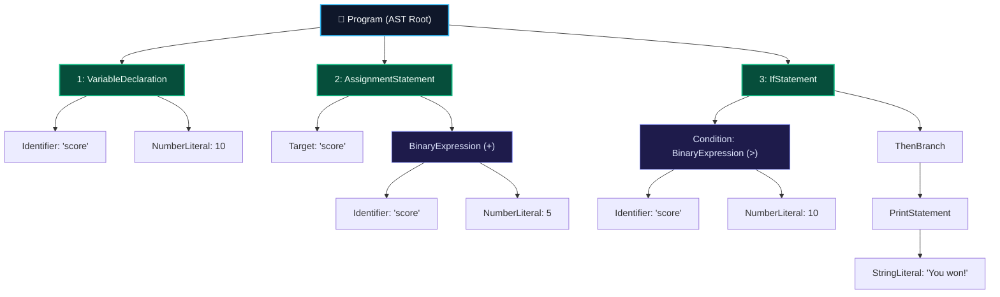
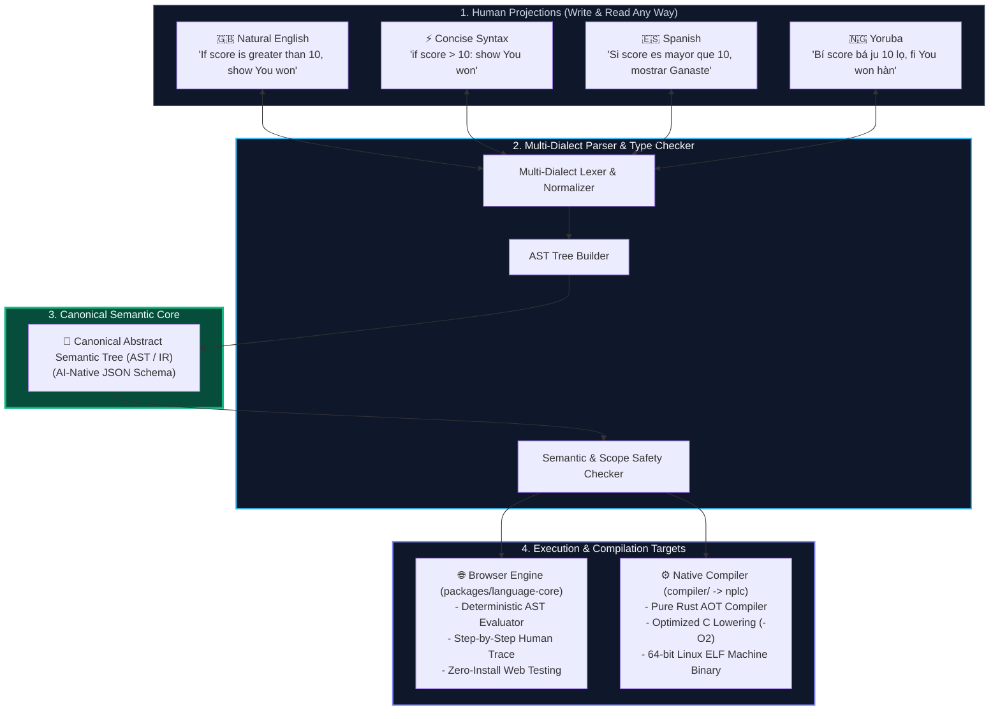
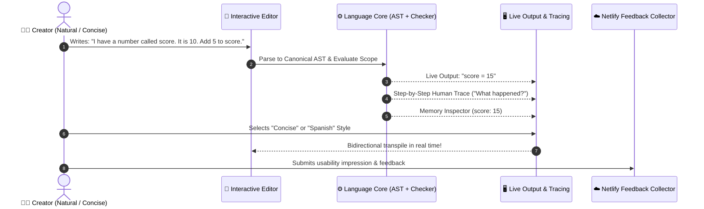

<p align="center">
  
</p>

<h1 align="center">NP-LANG</h1>

<p align="center">
  <strong>A programming language designed around how people express ideas.</strong><br>
  <em>Natural English · Concise Code · Native Dialects · AI-Native AST · Native Compilation</em>
</p>

<p align="center">
  <a href="https://vocal-tartufo-edf572.netlify.app/"></a>
  
  
</p>

<p align="center">
  
</p>

We are exploring a different way to write programs: using clear, human-readable instructions without sacrificing precise, predictable behavior.

NP-LANG is an open-source project. You can try the early playground, test its syntax, improve the language specification, or contribute to its implementation.

> **Project Status**: Experimental. The current playground demonstrates an early language prototype; native compilation and performance are still under active research and development.

---

## Quick Navigation

- [Try the Live Playground](#1-try-the-playground)
- [How NP-LANG Works: The Tree Model](#2-how-np-lang-works-the-tree-model)
- [System Architecture](#3-system-architecture)
- [What is NP-LANG Trying to Achieve?](#4-what-is-np-lang-trying-to-achieve)
- [What Works Right Now?](#5-what-works-right-now)
- [What We Are Building Next](#6-what-we-are-building-next)
- [How to Contribute](#7-how-to-contribute)
- [Repository Structure](#8-repository-structure)
- [Local Development](#9-local-development)

---

## 1. Try the Playground

You can test NP-LANG right in your browser with zero installation:

👉 **[Launch Live Playground](https://vocal-tartufo-edf572.netlify.app/)** *(or run locally with `npm run dev` at `http://localhost:5180`)*

### Quick Example: The Same Program in Three Styles

Every style maps to the exact same underlying program representation:

#### Natural English
```text
I have a number called score. It is 10.
Add 5 to score.
If score is greater than 10, show "You won!".
```

#### Concise Code
```text
let score = 10
score = score + 5
if score > 10: show "You won!"
```

#### Spanish (Español)
```text
Tengo un número llamado score. Es 10.
Sumar 5 a score.
Si score es mayor que 10, mostrar "¡Ganaste!".
```

---

## 2. How NP-LANG Works: The Tree Model

When you write instructions in NP-LANG—whether in conversational English, Concise code, or Spanish—the compiler translates your text into a **Canonical Abstract Semantic Tree (AST)**.

This tree is the unambiguous mathematical truth of your program:



Because the AST is the universal representation:
1. **Bidirectional Translation**: Any code can be projected into any supported human language or concise syntax.
2. **AI-Native Integrity**: AI coding agents can generate or refactor this JSON tree directly with **0% syntax errors**.
3. **Pluggable Backends**: The tree can execute in the browser via TypeScript or compile to native machine code via Rust.

---

## 3. System Architecture



---

## 4. What is NP-LANG Trying to Achieve?

Building software today forces creators to overcome artificial barriers:
1. **The Syntax Tax**: Missing semicolons, obscure brackets, and cryptic error messages intimidate beginners and vibe coders.
2. **The Verbosity Trap**: Forcing experienced engineers to type full sentences makes them reject natural languages. NP-LANG gives experienced developers **Concise Mode** while offering beginners **Natural Language**.
3. **Language Barriers**: Most programming languages assume English fluency. NP-LANG is designed from the ground up with modular locales (e.g. English, Spanish, Yoruba).
4. **AI-Native Representation**: Large Language Models often hallucinate syntax with brittle symbols. NP-LANG code maps directly to a clean, canonical Abstract Semantic Tree (AST) that AI systems can read, generate, and refactor reliably.

### Interactive Feedback & Playground Loop



---

## 5. What Works Right Now?

We believe in being completely transparent about what is ready today and what is still under development:

| Component | Status | Description |
| :--- | :--- | :--- |
| **Browser Playground** | **Available** | Interactive web editor with live evaluation, line-by-line *"What happened?"* explanations, and style translation. |
| **Language Core** | **Available** | Tokenizer, multi-style parser, semantic checker, and AST evaluator running in TypeScript. |
| **Core v0.1 Syntax** | **In Progress** | Variables, math, outputs, comparisons, branching (`if`), and loops (`repeat`). |
| **Language Specification** | **In Progress** | Formal definitions of keywords, grammar, and unambiguous program meaning. |
| **Native Compiler (`nplc`)** | **Early Prototype** | Rust-based Ahead-Of-Time (AOT) compiler producing standalone 64-bit Linux ELF machine binaries. |

---

## 6. What We Are Building Next

Our grounded, phased roadmap:
1. **Prototype Usability**: Test writing styles with beginners and experienced developers to discover what works and what feels too verbose.
2. **Language Specification v0.1**: Formalize syntax, scoping rules, and memory behavior to avoid ambiguities.
3. **Reliable Language Core**: Expand test coverage for edge cases, error diagnostics, and translations.
4. **Multilingual Syntax Research**: Systematize how mother-tongue grammars map to the universal AST without losing semantic fidelity.
5. **Native Compiler Development**: Expand the Rust compiler backend for optimizations, broader CPU architectures, and safe memory management.

Read our complete [Roadmap](docs/roadmap.md) and [Current Status](docs/current-status.md).

---

## 7. How to Contribute

**You do NOT need compiler development experience to contribute.**

| If you are a... | How you can help |
| :--- | :--- |
| **Beginner or Vibe Coder** | Try the tasks in the playground and tell us where instructions or error messages are confusing. |
| **Writer or Translator** | Help improve dictionary mappings, documentation, and examples for English, Spanish, Yoruba, or new languages. |
| **Language Designer** | Review the [Specification](spec/v0.1/grammar.md), help resolve edge cases, and eliminate ambiguity. |
| **Software Engineer** | Contribute to the parser, semantic analysis, automated test suites, or the Rust compiler backend. |

Read our full [Contributing Guide](CONTRIBUTING.md) to get started.

---

## 8. Repository Structure

```
nplang/
├── README.md                  # Project overview and entrypoint
├── CONTRIBUTING.md            # Contributor pathways and development guide
├── CODE_OF_CONDUCT.md         # Community standards
├── SECURITY.md                # Security vulnerability reporting
├── netlify.toml               # 1-click Netlify hosting configuration
├── render.yaml                # 1-click Render hosting configuration
│
├── docs/                      # Philosophy and planning
│   ├── assets/                # Visual branding, logos, and banners
│   ├── vision.md              # Long-term vision and design principles
│   ├── current-status.md      # Honest snapshot of working features
│   ├── language-design.md     # Architecture and multi-projection design
│   ├── roadmap.md             # Phased development roadmap
│   └── user-testing.md        # Usability tasks and feedback guide
│
├── spec/                      # Language specifications
│   └── v0.1/
│       └── grammar.md         # v0.1 grammar rules across all styles
│
├── locales/                   # Language dictionaries
│   ├── en/                    # English keyword mappings
│   ├── es/                    # Spanish keyword mappings
│   └── yo/                    # Yoruba keyword mappings
│
├── packages/                  # Monorepo packages
│   └── language-core/         # Standalone parser, checker, and evaluator
│       ├── src/
│       └── dist/
│
├── playground/                # Interactive web testing application
│   ├── src/
│   └── public/
│
├── compiler/                  # Native Rust compiler (nplc)
│   ├── src/                   # AST, parser, and native codegen in Rust
│   └── Cargo.toml             # Rust package configuration
│
└── examples/                  # Example NP-LANG source files (.np)
```

---

## 9. Local Development

### Prerequisites
- Node.js (v18+) & npm
- Rust & Cargo (optional, for native compilation)
- GCC (optional, for native ELF binary generation)

### Setup & Run
```bash
# Clone the repository
git clone https://github.com/victorejike/NPLANG.git
cd NPLANG

# Install workspace dependencies
npm install

# Run the test suite
npm test

# Start the interactive playground locally
npm run dev
```

### Build Native Binaries (with the Rust Compiler)
```bash
# Build the native compiler
cargo build --release --manifest-path compiler/Cargo.toml

# Compile an NP-LANG source file directly to a native machine executable
./compiler/target/release/nplc compile examples/score.np -o my_app

# Run the native executable on your CPU
./my_app
```

---

## License

MIT © 2026 VICTOR EJIKE — see [LICENSE](LICENSE) for details.
