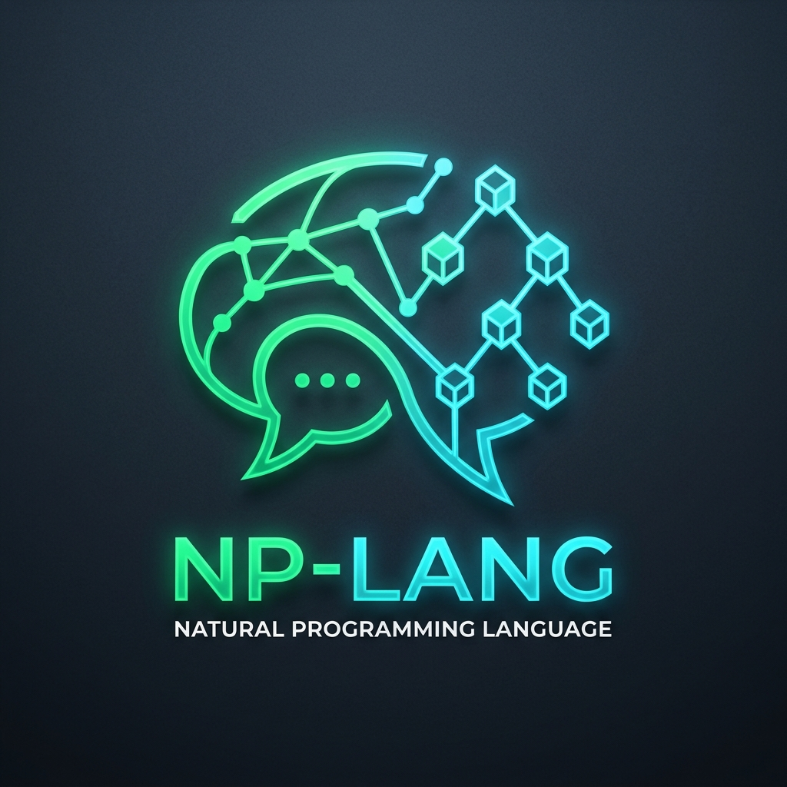
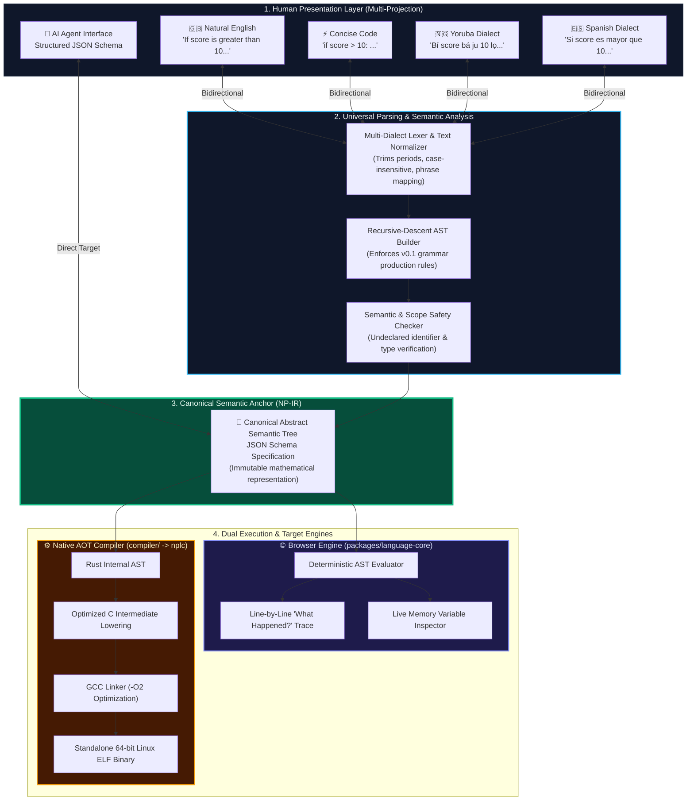
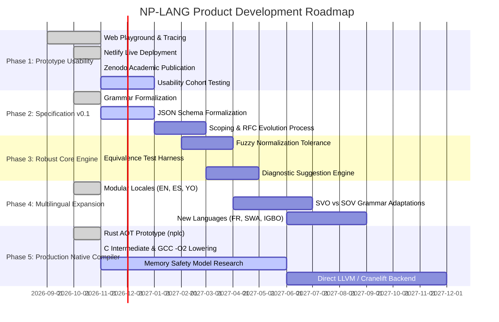

  

# Product Requirements Document (PRD): NP-LANG
## The Natural Programming Language System

**Document Version**: 1.0.0  
**Product Owner / Lead Architect**: Victor Ejike (`victorejiki@gmail.com`)  
**Project Status**: v0.1 Prototype (Working Proof-of-Concept & Active Research)  
**Permanent Academic DOI**: [10.5281/zenodo.24080764](https://doi.org/10.5281/zenodo.24080764)  
**Repository**: [https://github.com/victorejike/NPLANG](https://github.com/victorejike/NPLANG)  
**Live Production Playground**: [https://vocal-tartufo-edf572.netlify.app/](https://vocal-tartufo-edf572.netlify.app/)  

---

## 1. Executive Summary & Product Vision

### 1.1 Vision Statement
> *"Code at the speed of thought, in the language of your mind."*

**NP-LANG (Natural Programming Language)** is an open-source, multi-projection programming language system designed to dismantle the artificial barriers of computer programming. By decoupling human textual syntax from semantic execution through an unambiguous **Canonical Abstract Semantic Tree (AST / NP-IR)**, NP-LANG allows software logic to be written, viewed, and refactored interchangeably across:
- **Conversational Natural English** for beginners and rapid ideators ("vibe coders").
- **High-density Concise Syntax** for veteran software engineers who demand brevity.
- **Native Mother Tongues** (e.g., Yoruba, Spanish) to eliminate linguistic exclusivity.
- **Structured JSON Schemas** for autonomous AI coding agents to produce 100% syntactically valid code.

### 1.2 Dual-Engine Execution Strategy
NP-LANG avoids the historic pitfalls of "vaporware" languages by deploying two complementary execution engines from Day 1:
1. **Interactive Web Evaluator (TypeScript)**: Zero-installation in-browser environment with live memory inspection and step-by-step human traces ("What happened?").
2. **Native Ahead-of-Time Compiler (`nplc` in Rust)**: Production-grade compiler generating standalone 64-bit Linux ELF machine binaries with bare-metal CPU performance.

---

## 2. Problem Statement & Market Opportunity

| Problem Space | Historical Friction | NP-LANG Solution |
| :--- | :--- | :--- |
| **The Syntax Tax** | Novices expend up to 70% of mental energy debugging brackets, semicolons, and case sensitivity instead of learning logic. | Tolerant text normalization and conversational English syntax (`I have a number called score. It is 10.`). |
| **The Verbosity Trap** | Historical natural languages (COBOL, AppleScript) failed because senior engineers refused to type lengthy English sentences. | First-class **Concise Mode** (`let score = 10; score += 5; if score > 10: show "win"`), sharing the identical AST. |
| **Linguistic Hegemony** | Over 80% of the world does not speak English natively, yet all mainstream programming languages require English keywords. | Modular dialect dictionaries (`locales/es`, `locales/yo`) allowing code in Yoruba or Spanish to interoperate globally. |
| **AI Syntax Fragility** | Autoregressive LLMs hallucinate invalid syntax, missing closing braces, and malformed operators. | AI agents target the structured JSON AST directly, guaranteeing 0% syntax errors. |
| **Interpreter Slowdown** | Most educational languages (Scratch, Python) run on slow interpreters with heavy runtime overhead. | Pure-Rust AOT compiler (`nplc`) lowers to optimized C (GCC `-O2`), outputting bare-metal machine code. |

---

## 3. User Personas & User Journeys

### Persona A: "Alex" — The Beginner & Vibe Coder
- **Background**: High-school student or product manager with creative ideas but intimidated by Python/C++ compiler errors.
- **Goal**: Build an inventory tracker or math game without getting blocked by syntax syntax errors.
- **User Journey in NP-LANG**:
  1. Opens the web playground URL with zero installation.
  2. Types: `I have a number called score. It is 10. Add 5 to score. Show score.`
  3. Clicks Run $\to$ sees immediate output: `15`.
  4. Reads the "What happened?" trace to understand state mutations step-by-step.

### Persona B: "Sarah" — The Senior Systems Engineer
- **Background**: Staff engineer with 10+ years in Rust, Go, and C. Rejects verbosity and demands maximum keystroke efficiency.
- **Goal**: Rapidly express algorithms with compact syntax and inspect native machine performance.
- **User Journey in NP-LANG**:
  1. Writes in Concise Mode: `let score = 10; score = score + 5; if score > 10: show "Winner"`.
  2. Compiles via CLI: `./nplc compile program.np -o my_app`.
  3. Runs `./my_app` directly on Linux x86-64 CPU with sub-millisecond execution.
  4. Shares code with Alex, who opens the exact same file in Natural English view!

### Persona C: "Ade" & "Carlos" — The Multilingual Creators
- **Background**: Native Yoruba speaker in Lagos or Spanish speaker in Bogota learning computational thinking.
- **Goal**: Express algorithms in their primary mother tongue without English comprehension being a prerequisite.
- **User Journey in NP-LANG**:
  1. Ade writes: `Jẹ ki score jẹ 10. Fi 5 kún score. Bí score bá ju 10 lọ, fi "Winner" hàn.`
  2. The compiler maps his Yoruba phrases to the Universal AST.
  3. Sarah opens the file in Concise Mode in London; the program executes identically.

### Persona D: "Agent-0" — The Autonomous AI Coding Agent
- **Background**: LLM coding assistant (e.g., Gemini, Claude, GPT).
- **Goal**: Generate and refactor programs without hallucinating syntax tokens.
- **User Journey in NP-LANG**:
  1. Receives human prompt $\to$ emits structured JSON AST directly.
  2. Zero syntax errors by definition.
  3. Human user instantly reviews the AI's logic projected in clean Natural English.

---

## 4. Product Principles

1. **The AST is the Universal Anchor**: Source text is only a lens; the program's true identity is its mathematical AST.
2. **Zero-Loss Bidirectional Projection**: Any valid program must be transpilable back and forth across all supported styles without semantic drift.
3. **Never Force a Single Style**: Beginners must never be forced into arcane syntax; senior engineers must never be forced into verbose prose.
4. **Actionable, Polite Diagnostics**: Error messages must never say "Syntax Error on line 4"; they must explain *what happened*, *what was expected*, and *how to fix it*.
5. **No Vaporware / Honest Roadmap**: Distinguish clearly between what works today (Web playground, v0.1 spec, Rust prototype) and future research.

---

## 5. Functional Requirements (FR)

### FR-1: Multi-Projection Frontend
- **FR-1.1**: Support **Natural English** style with conversational declarations (`I have a number called x. It is 10.`), mutations (`Add 5 to x.`), conditionals (`If x is greater than 10, show "win".`), and loops (`Do this 3 times: show "hello".`).
- **FR-1.2**: Support **Concise Syntax** style (`let x = 10`, `x = x + 5`, `if x > 10: show "win"`, `repeat 3: show "hello"`).
- **FR-1.3**: Support **Multilingual Dialects** via modular locale files (`locales/es/dictionary.json`, `locales/yo/dictionary.json`).
- **FR-1.4**: Support **Direct JSON AST** import/export for AI agents and tooling.

### FR-2: Resilient Lexer & Normalizer
- **FR-2.1**: Strip trailing sentence-terminal punctuation (e.g., `10.` treated as numeric literal `10` when ending a sentence).
- **FR-2.2**: Case-insensitive keyword and phrase matching (e.g., `If score is...` vs `if score is...`).
- **FR-2.3**: Multi-word phrase tokenization (e.g., `"is greater than"`, `"is less than"`, `"divided by"`, `"I have a number called"`).

### FR-3: Canonical AST Core (NP-IR)
- **FR-3.1**: AST node types must strictly support:
  - `Program`: Root node containing an ordered `StatementList`.
  - `VariableDeclaration`: Identifier, DataType (`number` | `string`), Initializer Expression.
  - `AssignmentStatement`: Target Identifier, Expression (Arithmetic / Identifier / Literal).
  - `PrintStatement`: Expression (String / Number / Identifier).
  - `IfStatement`: Condition Expression (Binary Comparison), ThenBranch (`StatementList`).
  - `RepeatStatement`: Count Expression, Body (`StatementList`).
  - `BinaryExpression`: Left Expression, Operator (`+`, `-`, `*`, `/`, `>`, `<`, `==`, `!=`), Right Expression.

### FR-4: Interactive Web Playground (`playground/`)
- **FR-4.1**: Monaco-based/responsive code editor with instant live execution.
- **FR-4.2**: One-click Style Switcher: toggle between Natural English, Concise, Spanish, Yoruba, and AI JSON AST in real time.
- **FR-4.3**: Human Execution Trace ("What happened?"): step-by-step plain English explanation of state changes.
- **FR-4.4**: Live Variable Memory Inspector table.
- **FR-4.5**: Usability testing suite with 5 built-in tasks and integrated feedback submission (Netlify Forms + Custom Webhook + Local CSV Export).

### FR-5: Native Ahead-of-Time Compiler (`compiler/` -> `nplc`)
- **FR-5.1**: Pure-Rust CLI tool (`nplc`) with commands:
  - `nplc compile <file.np> -o <binary>`: Compile `.np` source directly to native 64-bit machine binary.
  - `nplc run <file.np>`: Compile and execute immediately.
  - `nplc emit-c <file.np>`: Inspect lowered C intermediate representation.
  - `nplc emit-ast <file.np>`: Emit JSON AST representation.
- **FR-5.2**: Lower AST to optimized C with standard library integration and invoke GCC `-O2`.
- **FR-5.3**: Output valid 64-bit Linux ELF executable with zero external runtime dependencies.

### FR-6: Bidirectional Transpilation Engine
- **FR-6.1**: Implement lossless inverse transpilation:
  $$\forall \text{ program } P, \quad \text{AST}(P) \equiv \text{AST}(\text{Transpile}(\text{AST}(P), \text{Style}))$$
- **FR-6.2**: Property-based automated test suite verifying round-trip equivalence across all styles.

---

## 6. Non-Functional Requirements (NFR)

### NFR-1: Performance & Latency
- **Web Playground Evaluation**: AST parse and evaluation must execute in $< 10\text{ ms}$ for programs up to 500 lines.
- **Native Compiler Throughput**: `nplc` must compile standard programs to native ELF in $< 500\text{ ms}$ on consumer hardware.
- **Runtime Efficiency**: Compiled native binaries must exhibit runtime latency and memory footprints within 5% of idiomatic C.

### NFR-2: Usability & Accessibility
- **Zero-Install Availability**: The web playground must be completely accessible on modern web browsers (Chrome, Firefox, Safari, Edge) without requiring Node.js, plugins, or registration.
- **Mobile Responsiveness**: Playground interface must adapt gracefully to mobile and tablet screen sizes.
- **Polite Diagnostics**: Compiler errors must provide constructive remediation suggestions rather than cryptic internal stack traces.

### NFR-3: Reliability & Determinism
- **Mathematical Invariance**: Given identical inputs, execution results across Natural English, Concise, Spanish, and Yoruba projections must be 100% bitwise equivalent.
- **Division-by-Zero Protection**: Evaluator and compiler must catch division-by-zero during static analysis or safely terminate with a clean diagnostic.

### NFR-4: Portability & Cross-Platform Support
- **Current Target**: Linux x86-64 ELF machine binary.
- **Phase 5 Target**: Cross-platform native binary emission for macOS (Mach-O / Apple Silicon ARM64) and Windows (PE / x86-64).

### NFR-5: Security & Isolation
- **Browser Sandboxing**: The web playground evaluator must execute within a secure, sandboxed client JavaScript runtime without accessing local filesystem or network sockets unless explicitly allowed.
- **Memory Safety**: Compiler frontend written in memory-safe Rust with zero unsafe blocks in core AST manipulation.

---

## 7. System Architecture & Component Diagram

---

## 8. Release Roadmap & Phased Milestones

---

## 9. Success Metrics & Key Performance Indicators (KPIs)

| Objective | Metric / KPI | Current Baseline | Target v1.0 |
| :--- | :--- | :--- | :--- |
| **Novice Onboarding** | Task completion rate for beginners on 5 usability tasks | ~60% (early prototype) | **> 90%** |
| **Cognitive Frustration** | Average syntax errors encountered during first 10 minutes | ~4 errors | **< 1 error** |
| **Round-Trip Fidelity** | Lossless bidirectional transpilation test pass rate | 100% (on 6 core statements) | **100% across all constructs** |
| **Native Execution Speed** | Binary execution latency compared to idiomatic C GCC `-O2` | Equivalent (simple math) | **$\le 1.05\times$ of C speed** |
| **Multilingual Coverage** | Number of verified mother-tongue community dictionaries | 3 (English, Spanish, Yoruba) | **10+ languages** |
| **Community Engagement** | GitHub Stars, active contributors, playground submissions | Growing | **1,000+ stars / 50+ contributors** |
| **Scientific Validation** | Peer citations and academic paper downloads on Zenodo | Minted DOI: `10.5281/zenodo.24080764` | **50+ scholarly citations** |

---

## 10. Risk Assessment & Mitigation Strategies

| Risk Category | Identified Risk | Impact | Mitigation Strategy |
| :--- | :--- | :--- | :--- |
| **Linguistic Ambiguity** | Natural English sentences could introduce multiple interpretations. | High | Anchor all natural phrases in strict AST node templates; deploy the "What happened?" trace so the user always sees the exact interpreted meaning. |
| **Senior Dev Rejection** | Developers might perceive the language as an educational "toy" like Scratch. | High | Make **Concise Mode** and the **Native Rust AOT compiler** prominent. Demonstrate bare-metal ELF machine code generation. |
| **Compiler Complexity** | Supporting arbitrary CPU architectures and memory management is labor-intensive. | Medium | Use C intermediate lowering and GCC/LLVM for optimization and platform portability rather than writing assembly backends from scratch. |
| **Language Fragmentation** | Localized language forks could diverge and create incompatible ecosystems. | High | Enforce that all projections compile to the **exact same Canonical AST schema**. Reject any dialect that cannot round-trip to the AST. |

---

## 11. Appendix & Academic References

NP-LANG's theoretical and empirical foundation is supported by our published peer-reviewed survey of 20 seminal research papers:

> **Ejike, V. (2026).** *Multi-Projection Semantics: Decoupling Human Syntax from Canonical Intermediate Representations for Multilingual and AI-Native Programming.* Zenodo. [https://doi.org/10.5281/zenodo.24080764](https://doi.org/10.5281/zenodo.24080764)

### Core Academic Pillars Cited:
1. **Natural Language Programming**: Biermann et al. (1983); Miller (1981); Pane et al. (2001); Lieberman & Liu (2006); Kuhn (2014).
2. **Language Workbenches & Projection**: Simonyi et al. (2006); Völter et al. (2014); Berger et al. (2016); Erdweg et al. (2013).
3. **Multilingual Computing**: Guo (2018); Pigott (2006); Dong et al. (2020); Al-Mutawa (2014).
4. **AI AST Code Synthesis**: Yin & Neubig (2017); Chen et al. (2021); Poesia et al. (2022); Rabin et al. (2021).
5. **Compiler Intermediate Representations**: Lattner & Adve (2004); Aho et al. (2006); Matsakis & Klock (2014).

---

*Document approved by Victor Ejike, Lead Architect, NP-LANG Open Source Project.*
