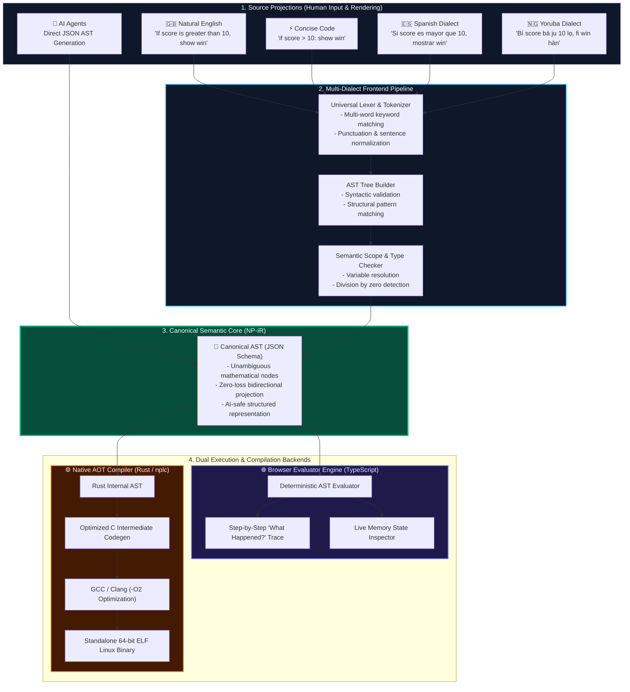
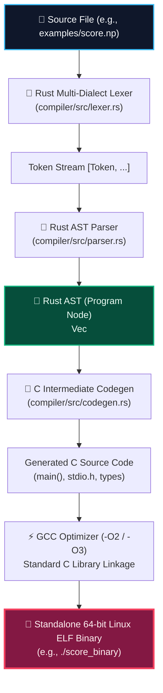
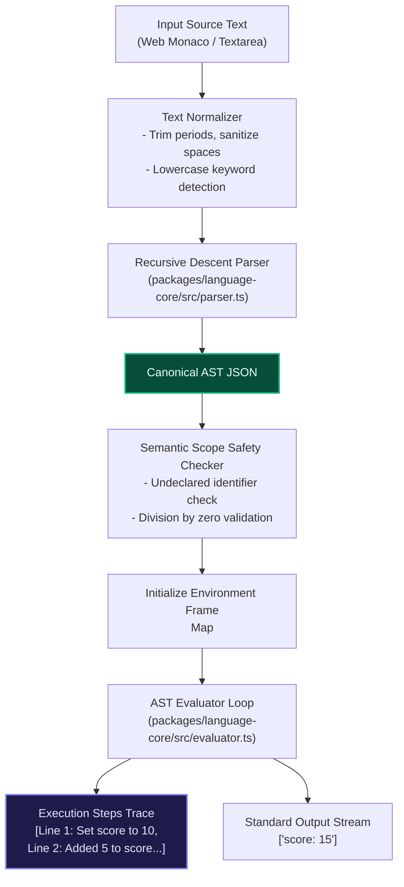
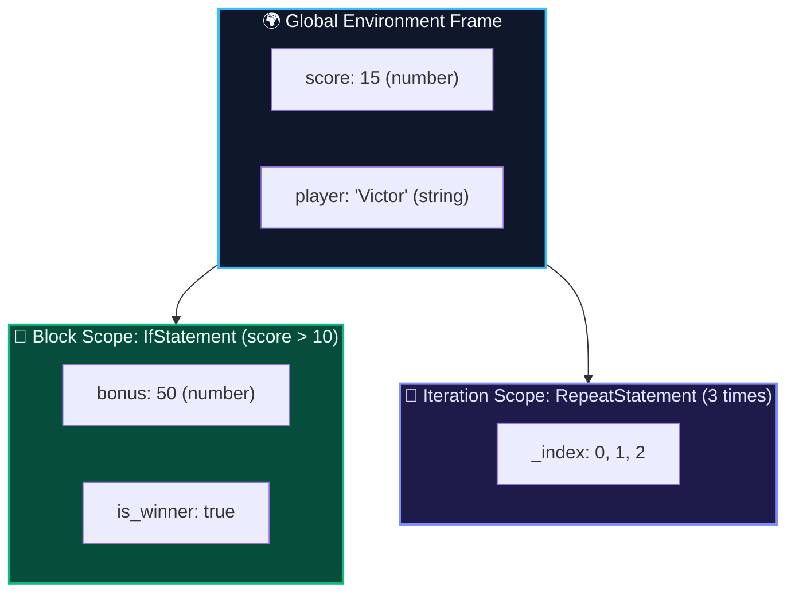
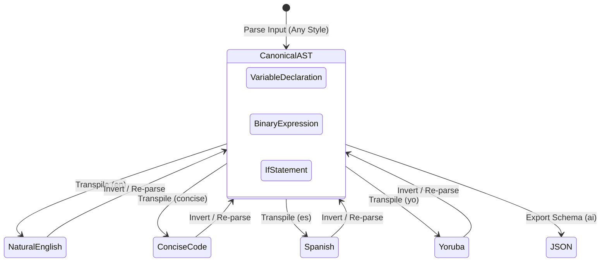

  

# NP-LANG Architecture

NP-LANG decouples human syntax from the language's core representation and execution model. Rather than treating source text as the immutable program, NP-LANG treats human text as a **projection** and the **Canonical Abstract Semantic Tree (AST)** as the universal truth.

---

## 1. System Overview Flowchart

---

## 2. Native Compilation Pipeline (`nplc`)

The native compiler backend is built in pure Rust. It transforms NP-LANG programs into bare-metal machine code with zero runtime overhead:

### Why Emit C as an Intermediate Target?
1. **Universal Portability**: C runs on virtually every CPU architecture in existence (x86, ARM, RISC-V, WebAssembly).
2. **Industrial-Grade Optimization**: We leverage 35+ years of GCC and LLVM compiler optimizations (`-O2`, auto-vectorization, dead code elimination) without reinventing backend assembly generation from day one.
3. **Transparent Debugging**: Developers can inspect the intermediate C code with `--emit-c` to see exactly what instructions are executed.

---

## 3. Browser Evaluation Pipeline (`packages/language-core`)

For instant, zero-install testing in the web playground, the language core executes entirely inside the browser:

---

## 4. Scoping & Memory Environment Model

Variable bindings exist inside a hierarchical scope chain:

---

## 5. Bidirectional Projections

Because every projection compiles into the same Canonical AST, NP-LANG provides a **lossless Bidirectional Transpiler**:

- Any valid Natural English program can be translated into Concise Syntax.
- Any Concise program can be projected into Natural English, Spanish, or Yoruba.
- An AI coding agent can generate the Canonical AST directly as JSON, and a human developer can read and edit it in Natural English.

