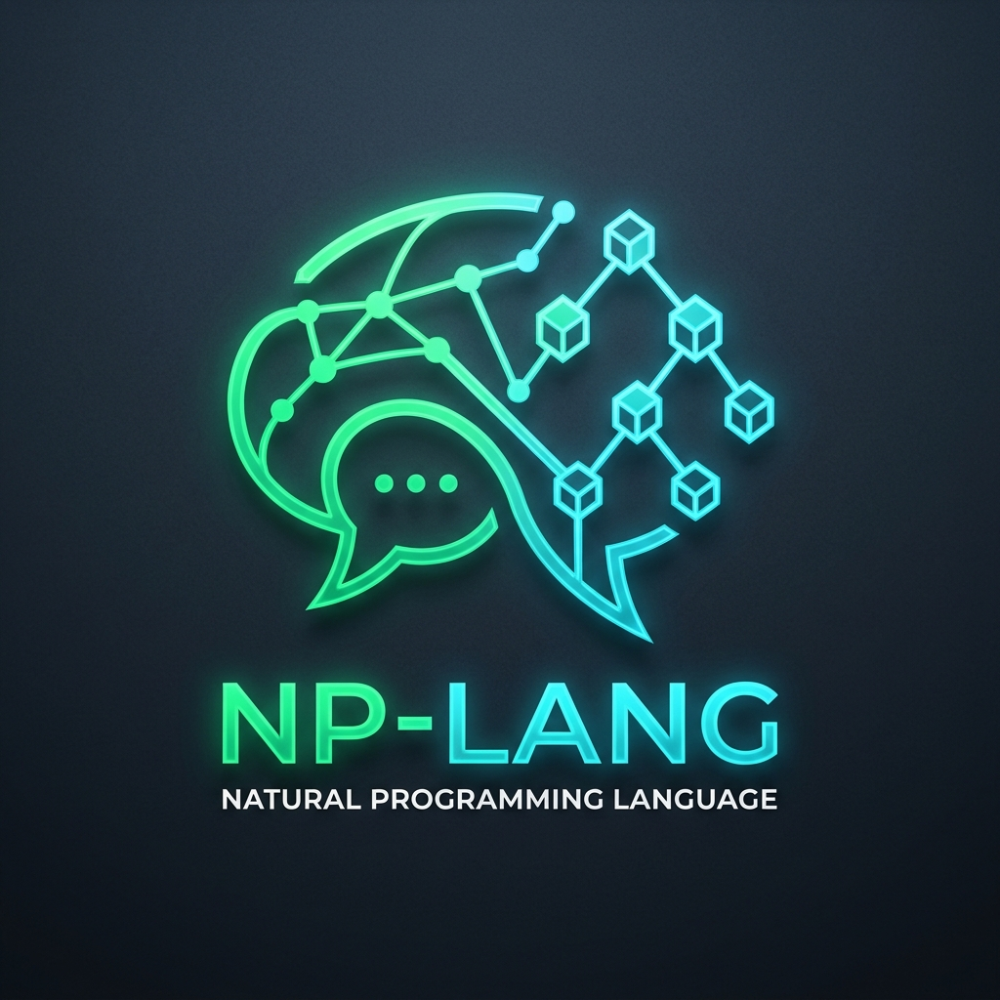
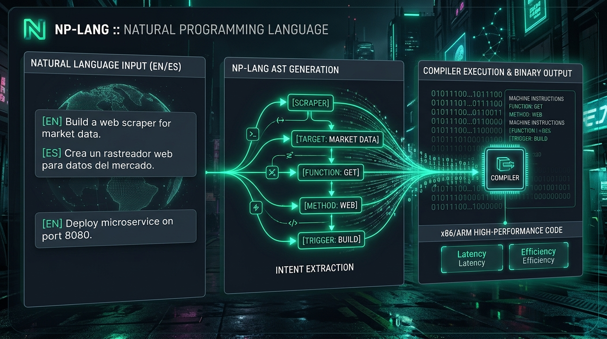
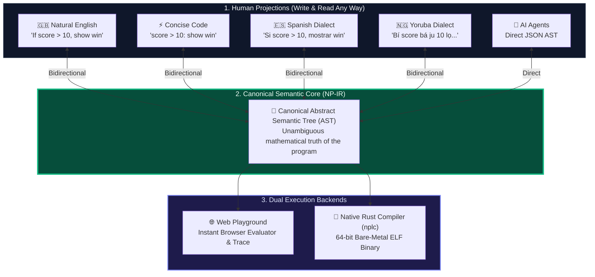

<p align="center">
  
</p>

# Welcome to NP-LANG: The Complete Project Guide

> **"Code at the speed of thought, in the language of your mind."**

<p align="center">
  <a href="https://vocal-tartufo-edf572.netlify.app/"></a>
  <a href="https://doi.org/10.5281/zenodo.24080764"></a>
  
  
</p>

<p align="center">
  
</p>

If you have been wondering what project we are building, what problem we are solving, what we have accomplished so far, or how you can be a part of this journey (technically, collaboratively, or financially), **this document is your complete master guide**.

---

## 🧭 Quick Navigation

1. [What is NP-LANG?](#1-what-is-np-lang)
2. [Why Does This Project Exist? (The Core Vision)](#2-why-does-this-project-exist-the-core-vision)
3. [What Have We Done So Far? (Real Working Milestones)](#3-what-have-we-done-so-far-real-working-milestones)
4. [Our Published Academic Research Paper](#4-our-published-academic-research-paper)
5. [The System Architecture & Tree Model](#5-the-system-architecture--tree-model)
6. [How You Can Contribute & Support Us](#6-how-you-can-contribute--support-us)
7. [Financial Sponsorship & Research Grants](#7-financial-sponsorship--research-grants)
8. [Community Links & Contact](#8-community-links--contact)

---

## 1. What is NP-LANG?

**NP-LANG (Natural Programming Language)** is an open-source programming language designed around how humans naturally think, speak, and express ideas.

For over 60 years, programmers have been forced to adapt their minds to computers—getting tripped up on missing semicolons, complex brackets, and cryptic compiler errors. 

NP-LANG changes this equation:
- **Beginners and vibe coders** can write instructions in plain, conversational English (`I have a number called score. It is 10. Add 5 to score.`).
- **Experienced senior engineers** can switch instantly to high-speed Concise syntax (`let score = 10; score = score + 5; if score > 10: show "win"`).
- **Global creators** can code in their native mother tongues, such as **Spanish** or **Yoruba** (`Jẹ ki score jẹ 10. Fi 5 kún score.`).
- **AI agents** can generate and refactor programs directly as structured JSON trees with **0% syntax errors**.
- **The computer** compiles the program into high-performance, native 64-bit machine binaries via our pure-Rust compiler (`nplc`).

---

## 2. Why Does This Project Exist? (The Core Vision)

Today, anyone trying to build software faces four artificial barriers:

```
[ Traditional Barriers ]                                 [ NP-LANG Solution ]
1. The Syntax Tax (Brackets, semicolons, errors)   --->   Natural English with tolerant normalization
2. English Hegemony (80%+ of world excluded)      --->   Modular native mother tongues (Yoruba, Spanish...)
3. The Verbosity Trap (Senior devs hate essays)     --->   First-class high-density Concise Mode
4. AI Syntax Hallucinations (Brittle text tokens)   --->   AI-native Canonical Abstract Semantic Tree (AST)
```

### The Breakthrough: Multi-Projection Semantics
In conventional languages (like C, Python, or Rust), the text source file **is** the program. If a semicolon is missing, the compiler crashes.

In NP-LANG, **the program is a mathematical Abstract Semantic Tree (AST)**. Text is simply a **projection** or lens. That means:
- A beginner can write in conversational English.
- A senior colleague can open the exact same file in Concise Mode.
- A teammate in Nigeria can review it in Yoruba, and a teammate in Mexico can review it in Spanish.
- **There is zero loss of meaning because all projections map to the exact same AST!**

---

## 3. What Have We Done So Far? (Real Working Milestones)

We believe in being 100% transparent and grounded. NP-LANG is not vaporware; we have built real, working components that you can test right now:

### ✅ 1. Live Interactive Web Playground (Zero Install)
- Deployed on Netlify: **[https://vocal-tartufo-edf572.netlify.app/](https://vocal-tartufo-edf572.netlify.app/)**
- Features real-time bidirectional style translation between Natural English, Concise, Spanish, Yoruba, and AI JSON.
- Features a line-by-line **"What happened?"** human execution trace explaining every variable change.
- Includes a live memory inspector and real-time usability feedback logging.

### ✅ 2. The Core Language Engine (`packages/language-core`)
- Built in TypeScript with a multi-dialect lexer, recursive-descent parser, and semantic safety checker.
- Includes comprehensive automated unit test suites (`npm test` passing 100%).

### ✅ 3. Pure-Rust Native AOT Compiler (`compiler/` -> `nplc`)
- Written in **100% pure Rust**.
- Compiles `.np` source files directly into **standalone 64-bit Linux ELF machine binaries** using GCC backend optimization (`-O2`).
- Verified on real programs: executing `./score_binary` runs directly on the bare-metal CPU with zero Node.js, zero Python, and zero VM overhead.

### ✅ 4. Multilingual Dictionaries
- Modular locale architecture (`locales/en`, `locales/es`, `locales/yo`).

### ✅ 5. Full Visual Branding & Complete Specification
- Modern visual logo and architecture hero banner.
- Complete v0.1 grammar specification (`spec/v0.1/grammar.md`) with visual Mermaid syntax trees for every core statement.

---

## 4. Our Published Academic Research Paper

To ensure our language design is grounded in rigorous scientific scholarship, we conducted a deep academic literature review surveying **20 seminal, peer-reviewed research papers** across computer science, human-computer interaction, and language theory.

Our comprehensive paper has been officially published and cataloged on **Zenodo (CERN)** as an open-access scientific preprint:

- **Paper Title**:  
  *Multi-Projection Semantics: Decoupling Human Syntax from Canonical Intermediate Representations for Multilingual and AI-Native Programming*
- **Author**: **Victor Ejike** (`victorejiki@gmail.com`)
- **Permanent DOI**: [`10.5281/zenodo.24080764`](https://doi.org/10.5281/zenodo.24080764)
- **Zenodo Official Link**: [https://zenodo.org/records/24080764](https://zenodo.org/records/24080764)
- **Local File in Repository**: [`docs/research-paper.md`](research-paper.md)

### Academic Citation (BibTeX)
```bibtex
@article{ejike2026multiprojection,
  author       = {Victor Ejike},
  title        = {Multi-Projection Semantics: Decoupling Human Syntax from Canonical Intermediate Representations for Multilingual and AI-Native Programming},
  journal      = {Zenodo Preprint},
  year         = {2026},
  month        = {November},
  doi          = {10.5281/zenodo.24080764},
  url          = {https://doi.org/10.5281/zenodo.24080764}
}
```

---

## 5. The System Architecture & Tree Model



---

## 6. How You Can Contribute & Support Us

**You do NOT need compiler engineering experience to contribute!** We need diverse perspectives from all backgrounds:

| If you are a... | How you can make a huge impact |
| :--- | :--- |
| **Beginner or Vibe Coder** | Test the [Live Playground](https://vocal-tartufo-edf572.netlify.app/)! Complete the 5 tasks and tell us where instructions or error messages feel confusing or awkward. |
| **Bilingual or Multilingual Speaker** | Help translate keywords and expand our dictionary files in `locales/` (e.g. French, German, Igbo, Hausa, Swahili, Hindi, Portuguese). |
| **Language Enthusiast or Educator** | Review the [v0.1 Grammar Spec](spec/v0.1/grammar.md), suggest cleaner English equivalences, and write tutorials. |
| **Software Engineer (TypeScript / React)** | Help improve our web playground, Monaco editor integration, and core AST evaluation engine in `packages/language-core/`. |
| **Systems / Compiler Engineer (Rust)** | Help expand our native Rust compiler (`compiler/` -> `nplc`), LLVM lowering, memory safety model, and native optimizations. |

Read our full [Contributing Guide](../CONTRIBUTING.md) to set up the project locally.

---

## 7. Financial Sponsorship & Research Grants

Building a modern programming language compiler, maintaining global web infrastructure, running automated testing pipelines, and publishing peer-reviewed research requires time, compute servers, and dedicated resources.

If you or your organization believe in democratizing programming for the world, you can support our research financially:

### What Your Financial Support Funds:
1. **Compute & Cloud Infrastructure**: Hosting high-availability web playgrounds, compiler CI/CD pipelines, and benchmarking servers.
2. **Dedicated Compiler Research**: Accelerating our Rust Ahead-of-Time compiler backend, memory safety research, and multi-platform support (Linux, macOS Apple Silicon, Windows).
3. **Open Access & Academic Publication**: Funding conference registrations, open-access publication fees, and empirical usability studies with global participants.
4. **Community Translation Grants**: Compensating native-speaker linguists to build and audit high-quality mother-tongue dictionaries across underrepresented languages.

### How to Sponsor or Donate:
- 💳 **Direct Sponsorship & Grants**: Contact lead researcher **Victor Ejike** directly at **`victorejiki@gmail.com`**.
- 🌟 **GitHub Sponsors**: [https://github.com/sponsors/victorejike](https://github.com/victorejike)
- 🤝 **Corporate / Institutional Partnerships**: If your university, lab, or company wants to partner on research grants or compute credits, please reach out via email.

Every sponsor will be permanently acknowledged in our repository, research paper acknowledgments, and playground documentation!

---

## 8. Community Links & Contact

- 🌐 **Live Web Playground**: [https://vocal-tartufo-edf572.netlify.app/](https://vocal-tartufo-edf572.netlify.app/)
- 💻 **GitHub Repository**: [https://github.com/victorejike/NPLANG](https://github.com/victorejike/NPLANG)
- 📄 **Academic Research Paper (Zenodo)**: [https://doi.org/10.5281/zenodo.24080764](https://doi.org/10.5281/zenodo.24080764)
- 📧 **Direct Inquiries & Sponsorship**: **victorejiki@gmail.com**

Join us in reshaping the future of how humanity talks to computers! 🌲⚡
