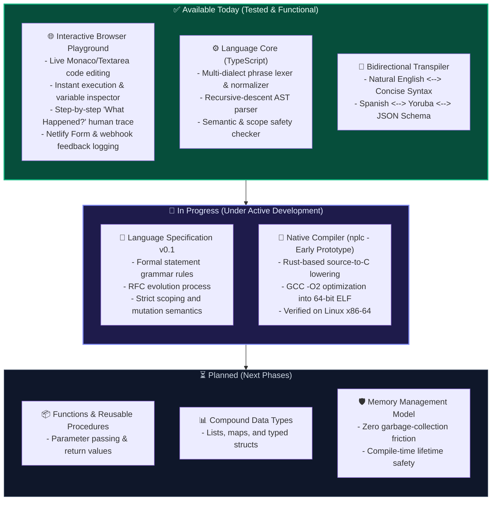
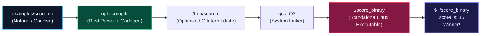

  

# NP-LANG Current Status

**Last Updated**: Version 0.1 (Working Prototype)

We believe that transparency about what works today—and what does not yet exist—is essential for building an honest, credible open-source project.

---

## 1. Executive Summary & Readiness Matrix

| Component | Status | Readiness Level |
| :--- | :--- | :--- |
| **Interactive Playground** | **Available** | Functional web prototype with real-time editing, output console, line-by-line trace explanation, and in-browser feedback survey. |
| **Language Core Engine** | **Available** | Deterministic AST parser, scope checker, and evaluator running in TypeScript. |
| **Bidirectional Projection** | **Available** | Dynamic translation between Natural English, Concise syntax, Spanish, Yoruba, and AI JSON AST. |
| **v0.1 Language Specification** | **In Progress** | Core syntax defined for variables, mutations, comparisons, branching, and repetition. |
| **Native AOT Compiler (`nplc`)** | **Early Prototype** | Rust-based compiler capable of compiling simple `.np` programs into standalone 64-bit Linux ELF machine binaries. |
| **Advanced Data Structures** | **Planned** | Lists, maps, structs, and objects are not yet implemented. |
| **Functions & Modules** | **Planned** | User-defined functions, arguments, return values, and module imports are under design. |
| **Memory Safety Model** | **Research** | Designing a safety model that avoids Rust's borrow-checker complexity while preventing memory corruption. |

---

## 2. What Works Today

### Supported Instructions
- **Variable Declarations**:
  - Natural English: `I have a number called score. It is 10.`
  - Concise: `let score = 10`
  - Spanish: `Tengo un número llamado score. Es 10.`
  - Yoruba: `Jẹ ki score jẹ 10.`
- **Arithmetic & Mutation**:
  - `Add 5 to score.` / `Sumar 5 a score.` / `score = score + 5`
  - `Subtract 3 from score.` / `Restar 3 de score.`
  - `Multiply score by 2.` / `Multiplicar score por 2.`
  - `Divide score by 2.` / `Dividir score entre 2.`
- **Display & Output**:
  - `Show score.` / `Mostrar score.` / `print score`
  - String literals: `Show "Hello world".`
- **Conditionals**:
  - `If score is greater than 10, show "Winner".`
  - `Si score es mayor que 10, mostrar "Ganaste".`
  - `if score > 10: show "Winner"`
- **Repetition**:
  - `Do this 3 times: show "Hello".`
  - `Repetir 3 veces: mostrar "Hola".`
  - `repeat 3: show "Hello"`

### The Browser Playground
- Runs on client devices with zero installation.
- Provides a step-by-step human explanation trace ("What happened?").
- Inspects live variable state in memory.
- Includes embedded usability tasks and a feedback collector connected to Netlify Forms, custom webhooks, and local CSV export.

### The Native Compiler Prototype (`nplc`)
- Written in Rust 1.98.
- Takes `.np` files, parses them into the Rust AST, generates optimized C code, and compiles them via GCC into native ELF 64-bit binaries.
- Successfully verified on Linux x86-64 machines.

---

## 3. What Does Not Work Yet (Active Research Areas)

1. **Functions and Procedures**:
   - Defining custom reusable procedures with parameters: `To calculate tax for income: ...`.
2. **Compound Data Types**:
   - Collections like lists (`a list of numbers called scores`) and key-value records.
3. **Complex Flow Control**:
   - While-loops, early break/continue, pattern matching, and error handling (`try / recover`).
4. **Platform Coverage**:
   - Native compilation is currently tested only on Linux x86-64. Windows (PE) and macOS (Mach-O / Apple Silicon) native targets are future work.
5. **Standard Library**:
   - File I/O, networking, graphics, and system calls.

---

## 4. An Important Truth About Claims

A working prototype is a strong starting point, but it does **not** yet prove:
- That NP-LANG's natural syntax is universally easier for every programmer.
- That its runtime performance is equivalent to mature systems like C or Rust on large-scale programs.
- That natural language instructions can cover every edge case without introducing ambiguity.

These questions can only be answered through **rigorous user testing, continuous language specification refinement, and reproducible benchmarks**. Contributors are invited to help test and answer these questions with us.
