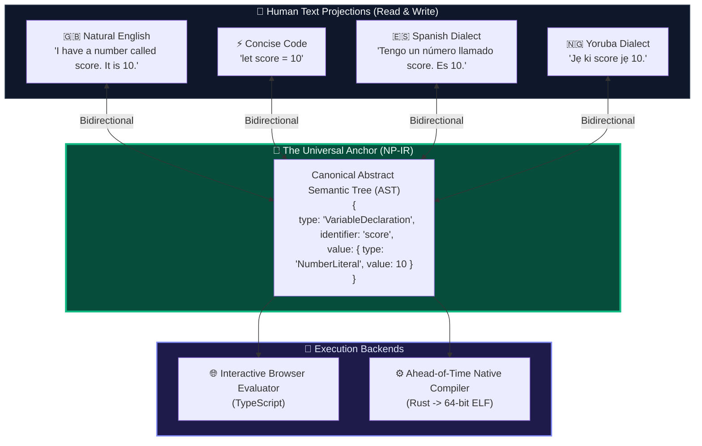
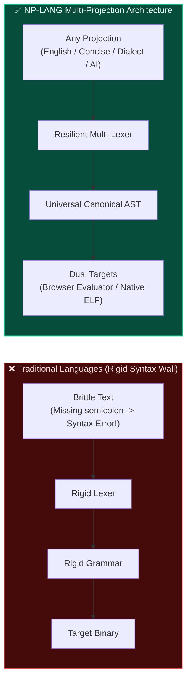
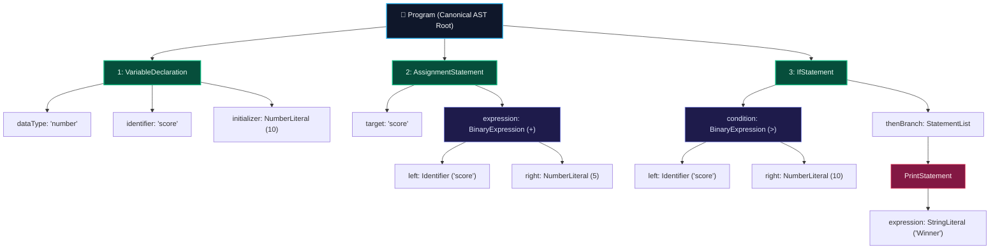
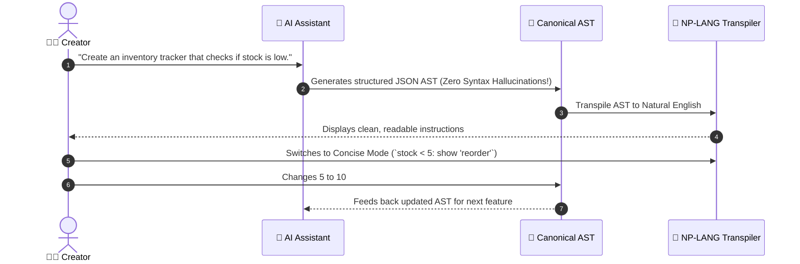

  

# NP-LANG Language Design Principles

## 1. The Core Idea: Multi-Projection Semantics

In conventional languages (like C, Python, or Rust), the text source code **is** the language. If you change a semicolon, a bracket, or an indentation level, the compiler rejects the program.

In NP-LANG, **the program is a Canonical Semantic Tree (AST)**. The text you write is simply a **projection** or lens:

Because all projections compile into the exact same mathematical AST:
- You can write in conversational English.
- An experienced colleague can read it in Concise syntax (`if score > 10: show "win"`).
- A native Spanish or Yoruba speaker can inspect it in their mother tongue.
- An AI coding agent can generate the AST directly in structured JSON with **zero syntax errors**.

---

## 2. Comparing Traditional Compilers vs. NP-LANG

---

## 3. The Dual-Syntax Parse Tree: How Natural & Concise Produce Identical Trees

Consider this program:
- **Natural**: `I have a number called score. It is 10. Add 5 to score. If score is greater than 10, show "Winner".`
- **Concise**: `let score = 10; score = score + 5; if score > 10: show "Winner"`

Both surface forms resolve to the identical AST nodes:

---

## 4. Why Both Concise and Natural Styles Exist

A common criticism of English-like programming is:
> *"Why would an experienced programmer type 'If score is greater than 10, show You won' when they can just write 'if score > 10: print("You won")'?"*

This objection is completely valid. If a language forces everyone to type long sentences, veteran programmers will reject it as too slow and verbose.

NP-LANG solves this by refusing to force a single style:

| Style | Purpose | Example |
| :--- | :--- | :--- |
| **Concise Mode** | Rapid writing for experienced coders | `let score = 10` `score = score + 5` `show score` |
| **Natural English** | Intuitive ideation for beginners & vibe coders | `I have a number called score. It is 10.` `Add 5 to score.` `Show score.` |
| **Multilingual Dialect** | Accessible coding in native tongues | `Tengo un número llamado score. Es 10.` `Sumar 5 a score.` `Mostrar score.` |

Both styles compile down to the same instructions and execute with identical results.

---

## 5. Learning from the Failures of COBOL and AppleScript

Past attempts at natural-language programming (such as COBOL, SQL, and AppleScript) struggled with a fundamental design flaw:
1. **The Illusion of English**: They looked like conversational English, but strictly enforced arcane, rigid grammar rules.
2. **Cryptic Failure**: If a user wrote a slightly different, perfectly valid English sentence, the compiler failed with incomprehensible errors.
3. **No Short Form**: Experienced developers had no way to write concise code, leading to frustrating verbosity.

### How NP-LANG Avoids These Traps
1. **Explicit Equivalences**: Rather than pretending any arbitrary English sentence is valid code, NP-LANG defines deliberate sets of equivalent phrase patterns.
2. **Clear Diagnostics**: When a sentence cannot be parsed, the engine explains exactly what it was expecting and suggests working alternatives.
3. **Canonical AST as the Anchor**: The meaning is tied to a formal schema, not an ambiguous natural language parser guessing user intent.

---

## 6. The AI-Native Advantage

Large Language Models (LLMs) are revolutionary at generating ideas, but brittle at writing rigid source code across dozens of languages. A missing brace or misremembered library import can crash a build.

NP-LANG is AI-native because:
1. **Structured AST Interface**: An AI can output the program directly as structured JSON nodes (`VariableDeclaration`, `AssignmentStatement`, `IfStatement`).
2. **Zero Hallucinated Syntax**: By targeting the Canonical AST directly, an AI agent achieves 100% syntactically correct code generation.
3. **Instant Human Legibility**: The human developer can view that AI-generated AST projected into clean Natural English or Concise syntax instantly.

