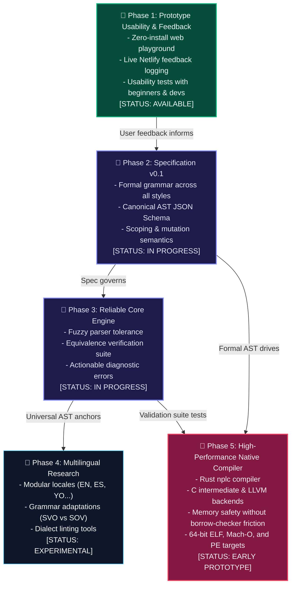

  

# NP-LANG Development Roadmap

This document outlines the phased development roadmap for NP-LANG. We prioritize verifiable milestones and user research over arbitrary calendar dates.

---

## 🗺️ Roadmap Architecture & Phase Progression

---

## 📍 Phase 1: Prototype Usability & User Feedback (Current Focus)

**Goal**: Validate the core user experience before over-investing in compiler infrastructure.

- [x] Build zero-installation browser playground.
- [x] Support 3 distinct writing styles (Natural English, Concise code, and Spanish/Yoruba).
- [x] Provide step-by-step human execution traces ("What happened?").
- [x] Deploy prototype on web hosting (Netlify/Render) with live feedback collection.
- [ ] Conduct structured usability tests across 3 user groups (beginners, experienced coders, AI-assisted devs).
- [ ] Analyze feedback on syntax verbosity: Does natural language feel intuitive or too wordy?

---

## 📍 Phase 2: Language Specification v0.1

**Goal**: Establish unambiguous semantic rules so that code behavior is deterministic and independent of any AI model or interpreter implementation.

- [x] Define grammar for basic statements (variables, mutation, output, branching, loops).
- [ ] Define formal variable scoping rules (block scope vs. procedure scope).
- [ ] Specify error-handling semantics (how runtime failures are caught and reported).
- [ ] Formalize the Canonical Abstract Semantic Tree (AST) schema in JSON Schema format.
- [ ] Publish RFC (Request For Comments) process for language design decisions.

---

## 📍 Phase 3: Reliable Language Core Engine

**Goal**: Transform the experimental prototype parser into a robust, edge-case-tested language engine.

- [x] Multi-style tokenizer and AST parser in TypeScript.
- [x] Semantic checking for undeclared variables and division by zero.
- [x] Bidirectional transpiler between supported styles.
- [ ] Fuzzy parser resilience (handling minor grammatical variations, punctuation differences, and polite phrasing).
- [ ] Comprehensive equivalence test suite (verifying that all supported styles compile to 100% identical ASTs).
- [ ] Rich, diagnostic error messages with actionable suggestions.

---

## 📍 Phase 4: Multilingual Syntax Research

**Goal**: Systematically support mother tongues without degrading program precision.

- [x] Modular dictionary structure (`locales/en`, `locales/es`, `locales/yo`).
- [ ] Community translation guidelines for contributing new language packs.
- [ ] Grammar structure adaptation for Subject-Verb-Object (SVO) vs. Subject-Object-Verb (SOV) languages.
- [ ] Automated linting for dialect dictionaries to ensure completeness.

---

## 📍 Phase 5: Native Compiler Research and Implementation

**Goal**: Build a high-performance Ahead-Of-Time (AOT) compiler producing standalone native executables.

- [x] Early proof-of-concept Rust compiler (`nplc`) compiling basic `.np` files to 64-bit Linux ELF binaries.
- [ ] Design disciplined memory management model (automatic cleanup without garbage collection pauses or borrow-checker friction).
- [ ] Native support for user-defined functions and recursion.
- [ ] LLVM / Cranelift intermediate representation integration for direct machine-code generation.
- [ ] Cross-platform support for macOS (Mach-O / ARM64) and Windows (PE / x86-64).
- [ ] Performance benchmark suite comparing NP-LANG native binaries against equivalent C, Rust, and Go implementations.

---

## How to Follow or Influence the Roadmap

All roadmap discussions happen openly on GitHub:
- Check out the [Discussions and Issues](https://github.com/victorejike/NPLANG/issues) tagged `roadmap` or `language design`.
- To propose additions or revisions, open an issue using the [Language Design Proposal template](../.github/ISSUE_TEMPLATE/language_design.md).
