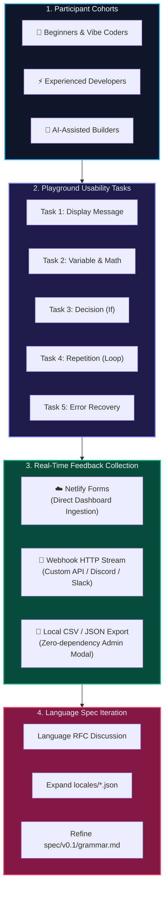

  

# NP-LANG User Testing Guide

We test NP-LANG with real people before finalizing compiler design decisions. Rather than assuming what people want, we gather empirical evidence to discover what actually helps creators and what gets in their way.

---

## 🔄 Usability Testing & Feedback Loop

---

## 👥 The Three Testing Cohorts

| Cohort | Who They Are | What We Want to Learn |
| :--- | :--- | :--- |
| **Beginners & Vibe Coders** | People who have never coded, or have struggled with conventional syntax. | Can they successfully express their intent without getting stuck on brackets or punctuation? |
| **Experienced Developers** | People fluent in Python, C, Rust, Go, or JavaScript. | Does NP-LANG feel unnecessarily verbose? Would they use Concise Mode? What feels missing? |
| **AI-Assisted Builders** | People who build software primarily using AI tools and prompts. | Does a natural-language AST make inspecting and steering AI-generated software easier? |

---

## 📋 The 5 Usability Tasks

When conducting a testing session, ask the participant to complete these 5 small tasks using the [Live Playground](https://vocal-tartufo-edf572.netlify.app/) (or local instance). Do **not** explain the syntax in advance—let them write naturally:

### Task 1: Display a Message
> **Prompt**: "Make the computer show 'Hello NP-LANG'."
- *Observe*: Do they type `show "Hello NP-LANG"`, `Display "Hello NP-LANG"`, `Print...`, or a full sentence?

### Task 2: Create a Value and Change It
> **Prompt**: "Create a number called score with value 10. Add 5 to it. Show the result."
- *Observe*: Do they write `let score = 10`, `I have a number called score...`, or `score = 10`? Do they use `Add 5 to score` or `score = score + 5`?

### Task 3: Make a Decision
> **Prompt**: "Create score with value 20. If score is greater than 10, show 'You won'."
- *Observe*: How do they structure the condition? Do they write `if score > 10:`, `If score is greater than 10...`, or `When score is more than 10...`?

### Task 4: Repeat an Action
> **Prompt**: "Show 'Hello' 3 times."
- *Observe*: Do they write `repeat 3: ...` or `Do this 3 times: ...`?

### Task 5: Find and Fix a Mistake
> **Prompt**: Give them a program with an error (e.g., `show total` before `total` exists) and observe whether the diagnostic suggestion helps them resolve it immediately.

---

## ❓ Post-Test Interview Questions

After completing the tasks, ask these questions:
1. **Style Preference**: *"Which style felt most comfortable to you: Natural English, Concise Code, or your native language?"*
2. **Verbosity**: *"Did writing full sentences feel intuitive, or did it feel like too much typing?"*
3. **Clarity**: *"When reading the step-by-step trace ('What happened?'), did you feel you understood what the computer did?"*
4. **Real-World Value**: *"Would you consider using this for a real project? Why or why not?"*

---

## 💡 How Testing Informs Language Design

- If **beginners** still struggle with natural sentences, the issue is likely the conceptual model, not just the syntax.
- If **experienced programmers** consistently avoid full sentences, Concise Mode must remain a first-class citizen, never an afterthought.
- If users write phrases that fail to parse, those phrase variations are recorded and evaluated for inclusion in the specification dictionary.
