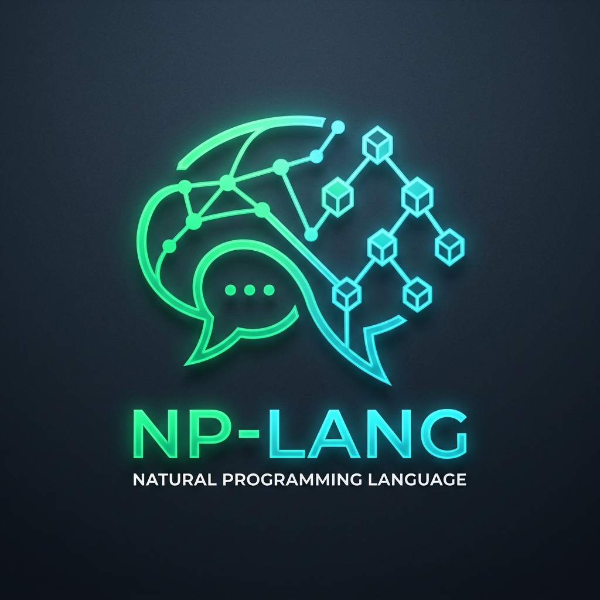
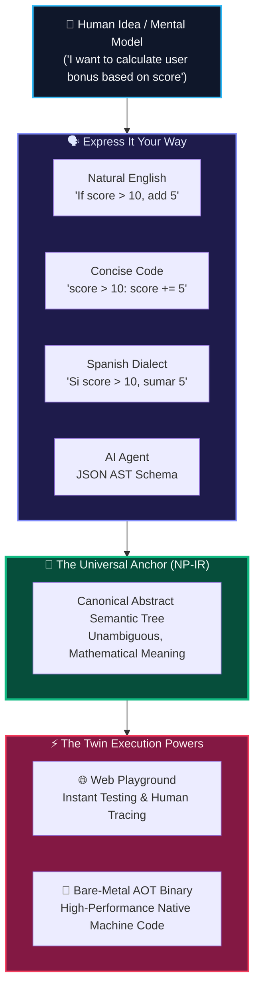

  

# NP-LANG: Natural Programming Language

> **"Code at the speed of thought, in the language of your mind."**

---

## 💡 The Core Vision

---

## 1. The Core Problem

For over fifty years, writing software has required humans to adapt to computers rather than computers adapting to humans. 

A creator with a clear vision—whether for a mobile app, web platform, or embedded device—must overcome artificial barriers:
1. **The Syntax Tax**: Missing semicolons, obscure brackets, mismatched indentation, and cryptic compiler errors.
2. **Language Fragmentation**: Needing C/Rust for system performance, Python for machine learning, JavaScript for user interfaces, and SQL for databases.
3. **The Verbosity vs. Simplicity Trap**: Beginners are intimidated by complex ceremony; experienced engineers are alienated by verbose pseudo-English (the historic failure of COBOL and AppleScript).
4. **AI Hallucinations**: Modern AI models struggle with brittle text syntax across different languages, causing subtle bugs and compilation failures.

---

## 2. The NP-LANG Philosophy

NP-LANG is built on five foundational tenets:

### Tenet 1: Multi-Projection Semantics
A program's truth lives in a **Canonical Semantic AST (Abstract Semantic Tree)**. Source text is simply a lens or projection:
- **Natural English**: For beginners, vibe coders, and conversational ideation.
- **Concise Code**: For experienced developers who want compact, rapid syntax (`if score > 10: show "win"`).
- **Native Dialects**: For multilingual empowerment (e.g., Yoruba, Spanish).
- **AI Structured JSON**: For zero-syntax-error agentic generation and automated refactoring.

A developer can write in Natural English, switch the view to Concise code or Yoruba, and the program's behavior remains identical.

### Tenet 2: Learning from C and Rust
- **From C**: We inherit bare-metal simplicity, predictable memory layout, direct ABI compatibility, and zero-cost abstraction.
- **From Rust**: We inherit disciplined memory safety, expressive type systems, and compiler diagnostics that teach and guide rather than merely complain.
- **Beyond Both**: We remove the cognitive barrier of arcane syntax and lifelong language obsolescence.

### Tenet 3: Grounded Execution (Two-Phase Engineering)
We avoid the vaporware trap:
- **Phase 1 (Playground & Usability Validation)**: Instant, zero-installation browser engine with step-by-step execution traces and user feedback.
- **Phase 2 (Native Compiler Backend)**: Ahead-of-Time (AOT) compiler emitting native machine code (via LLVM and C intermediate targets) for production workloads.

---

## 3. Supported Audience

| Audience | How NP-LANG Serves Them |
| :--- | :--- |
| **Vibe Coders & Beginners** | Express ideas in plain sentences without learning esoteric syntax rules. |
| **Experienced Developers** | Concise mode provides maximum brevity with systems-level performance. |
| **Multilingual Creators** | Code in their native language (e.g., Yoruba) without English being a barrier. |
| **AI Agents & Assistants** | Manipulate ASTs directly as structured data without parsing text hallucinations. |
