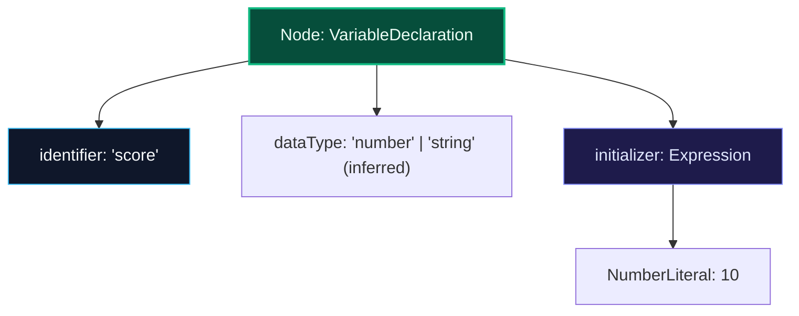
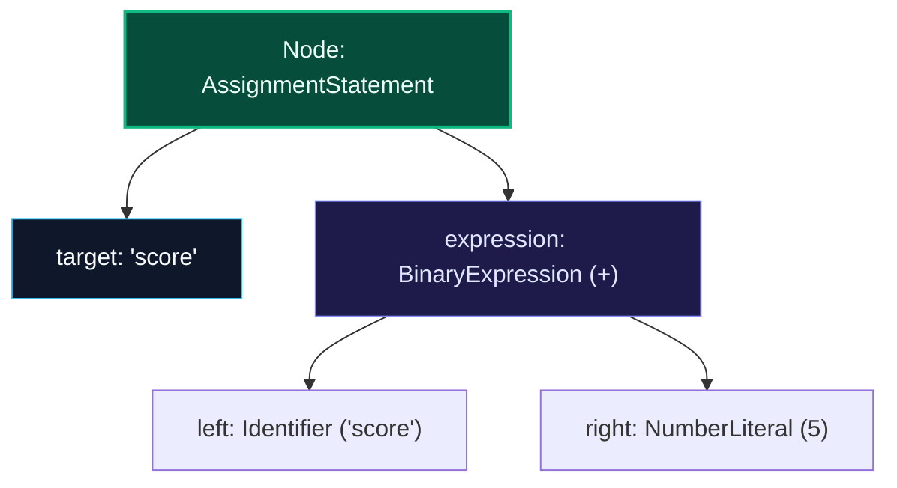
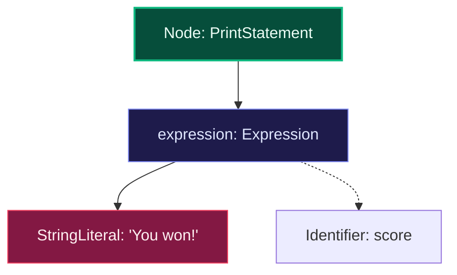
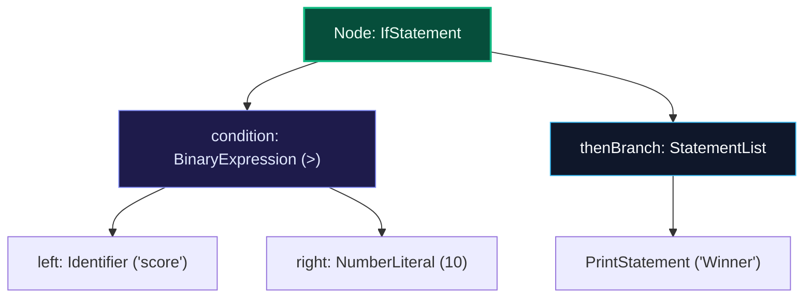
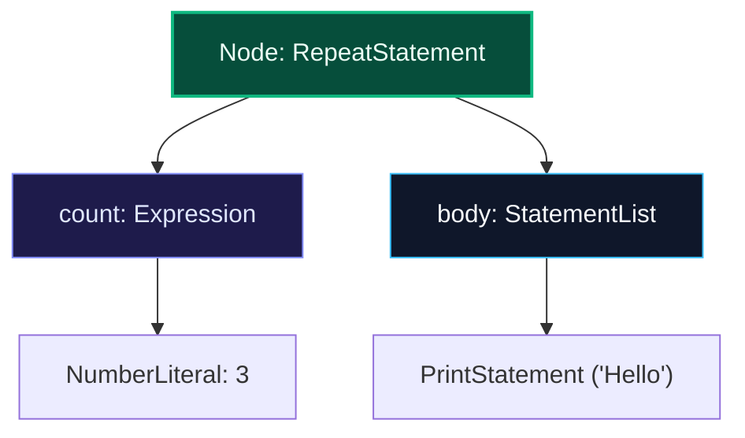
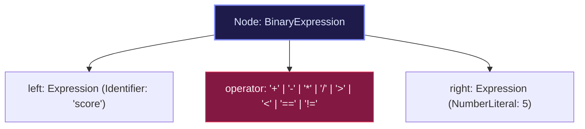
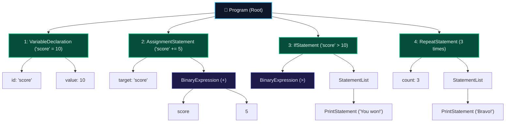

<p align="center">
  
</p>

# NP-LANG Specification v0.1

This document specifies the initial instruction set supported by the NP-LANG Core Engine and Interactive Playground. Every human surface syntax projects down to the formal Abstract Semantic Tree (AST) node structures detailed below.

---

## 1. Value Creation (Variable Declaration)

### Canonical AST Node Tree


### Concise Syntax
```
let <id> = <expr>
<id> = <expr>
```
*Example*: `let score = 10`

### Natural English
```
I have a number called <id>. It is <expr>.
Create <id> with value <expr>.
Let <id> be <expr>.
```
*Example*: `I have a number called score. It is 10.`

### Yoruba Dialect
```
Mo ní nọ́mbà kan tí à ń pè ní <id>. Ó jẹ́ <expr>.
Jẹ ki <id> jẹ <expr>.
Ṣẹ̀dá <id> pẹ̀lú iye <expr>.
```
*Example*: `Jẹ ki score jẹ 10.`

---

## 2. Value Mutation (Assignment & Arithmetic)

### Canonical AST Node Tree


### Concise Syntax
```
<id> = <expr>
add <expr> to <id>
subtract <expr> from <id>
multiply <id> by <expr>
divide <id> by <expr>
```
*Example*: `score = score + 5` or `add 5 to score`

### Natural English
```
Add <expr> to <id>.
Subtract <expr> from <id>.
Multiply <id> by <expr>.
Divide <id> by <expr>.
Set <id> to <expr>.
Change <id> to <expr>.
```
*Example*: `Add 5 to score.`

### Yoruba Dialect
```
Fi <expr> kún <id>.
Yọ <expr> kúrò nínú <id>.
Sọ <id> di <expr>.
```
*Example*: `Fi 5 kún score.`

---

## 3. Display / Output

### Canonical AST Node Tree


### Concise Syntax
```
show <expr>
print <expr>
```
*Example*: `show score`

### Natural English
```
Show <expr>.
Display <expr>.
Tell me <expr>.
Print <expr>.
```
*Example*: `Show score.` or `Tell me "You won".`

### Yoruba Dialect
```
Fi <expr> hàn.
Sọ fún mi <expr>.
Sọ <expr>.
```
*Example*: `Fi score hàn.` or `Sọ fún mi "O ti borí".`

---

## 4. Conditional Branching

### Canonical AST Node Tree


### Concise Syntax
```
if <condition>: <statement>
if <condition>:
    <statement...>
```
*Example*: `if score > 10: show "Winner"`

### Natural English
```
If <condition>, show <expr>.
If <condition>, then <statement>.
When <condition>, <statement>.
```
*Example*: `If score is greater than 10, show "Winner".`

### Yoruba Dialect
```
Bí <condition> bá rí bẹ́ẹ̀, <statement>.
Bí <condition> bá ju <expr> lọ, <statement>.
Nígbà tí <condition>, <statement>.
```
*Example*: `Bí score bá ju 10 lọ, fi "Winner" hàn.`

---

## 5. Repetition / Loops

### Canonical AST Node Tree


### Concise Syntax
```
repeat <n>: <statement>
repeat <n> times:
    <statement...>
```
*Example*: `repeat 5: show "Hello"`

### Natural English
```
Repeat <n> times: <statement>.
Do this <n> times: <statement>.
```
*Example*: `Do this 5 times: show "Hello".`

### Yoruba Dialect
```
Ṣe èyí ní ẹ̀mẹwàá <n>: <statement>.
Tún ṣe ní ẹ̀mẹwàá <n>: <statement>.
```
*Example*: `Ṣe èyí ní ẹ̀mẹwàá 5: fi "Hello" hàn.`

---

## 6. Expressions and Comparisons

### Canonical AST Node Tree (BinaryExpression)


| Concept | Concise | Natural English | Yoruba |
| :--- | :--- | :--- | :--- |
| Greater than | `a > b` | `a is greater than b`, `a is more than b` | `a ju b lọ` |
| Less than | `a < b` | `a is less than b`, `a is smaller than b` | `a kere ju b lọ` |
| Equal to | `a == b` | `a is equal to b`, `a is b` | `a dọ́gba pẹ̀lú b` |
| Not equal to | `a != b` | `a is not equal to b`, `a is not b` | `a kò dọ́gba pẹ̀lú b` |
| Addition | `a + b` | `a plus b`, `add a and b` | `a àti b`, `fi a kún b` |
| Subtraction | `a - b` | `a minus b` | `a yọ b` |
| Multiplication | `a * b` | `a times b`, `a multiplied by b` | `a sọ di b` |
| Division | `a / b` | `a divided by b` | `a pín sí b` |

---

## 7. Complete Program Compound AST Tree

When multiple statements are written together, they assemble into an ordered `StatementList` within the root `Program` node:



